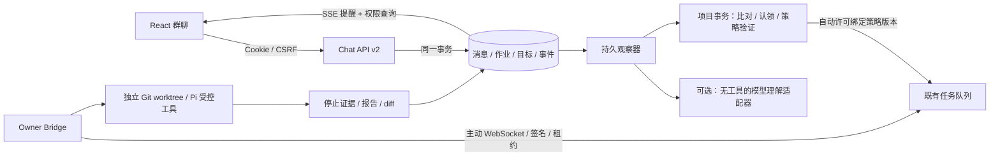

# 群聊协调主链路

## 部署与职责

MVP 由一个主设备运行 Web/API、数据库、观察协调器，Bridge 提供同机或受控设备的执行连接。Owner Node 是设备，人类项目维护者设置预授权策略。正式前端仅有群聊工作界面，其他功能在同页侧栏与短表单中完成。

模型适配器位于 packages/agent-runtime；API 编排位于 apps/api/src/modules/chat；纯提及与目标归一规则位于 packages/domain。浏览器不导入服务端 I/O。

正式页面入口是 apps/web/src/app/App.tsx 与 features/chat。既有 features/tasks、features/sources、features/memories 暂留兼容，未作为新主界面路由；DevicesView 在主设备侧栏复用。父目录 03\_群聊协作原型.html 仍是独立评审文件，不参与正式构建。

## 一致性边界

- 消息序号、结构化 mentions 与 observation_jobs 同事务提交；重复 client_message_id 返回同一消息，不重复观察。不同正文重用同一 ID 被拒绝。
- HTTP 不等待模型。观察器先取作业，再在数据库事务外调用有超时的理解端口；返回后进入项目协调事务，核对目标版本、已有占用、设备策略与来源版本。
- 精确效果键包含归一目标、范围、仓库／基线／能力、验收、约束和资料引用版本。语义同义匹配必须指向提供给模型的稳定目标，并重新检查版本及具体字段；明确差异不能被模型的 same 覆盖。
- 相近关系先澄清。成员在复核中补充具体范围／验收差异后可形成不同有效目标；共享写入仍经单一执行槽，不能把“不同目标”理解为允许冲突并行。
- 自动许可 approver_id 使用 node:coordinator，绑定政策版本；不会临时把普通成员伪装为人类 OWNER 来调用旧批准接口。
- 策略修改后旧队列过期，旧活动尝试发送停止并失去续租权。未知是否停止时保留 RECONCILING 槽位。
- 群停止指令仅接受明确 @AI 停止／叫停 加本群唯一的完整目标标题或 ID；模糊匹配不会随意停止其他目标。

## 权限与可见性

私有群的访问来自成员关系，维护者不因角色获得隐式读权。跨私群精确重复在协调器内比对，响应只投影“存在相关工作”的受限信号，不发送另一群 ID、成员、消息或目标 ID。旧 v1 读接口同样受群 ACL 约束，避免通过历史路由绕开新版限制。

v1 继续承担账号、设备配对、底层任务协议与资料版本接口，正式聊天主流程使用 v2。旧审批端点保留兼容，不再是新 UI 的必经入口。迁移使用追加 SQL，旧会话／任务／成果继续保留。

## 上下文与记忆

目标理解端口使用近期群消息与有权工作候选；执行端继续使用冻结的完整目标、限制、验收和带来源的历史摘录。工作索引是协调事实，候选／已确认记忆是可引用知识，两者不互相冒充。模型输出不能直接修改策略或确认记忆。

理解层目前不是全历史语义检索系统；覆盖预算、错误与真实质量边界见 [实现状态](../qa/implementation-status.md)。恢复、原文回读、Pi 工具与 worktree 的原有不变量仍适用。

## 模型端口

配置使用标准 chat/completions JSON 响应，显式启用 json_object 并验证 finish_reason 与输出 schema；空内容、截断、超时或多余授权字段都不能变成执行许可。协议依据见 [DeepSeek JSON 输出说明](https://api-docs.deepseek.com/guides/json_mode/)。

协调器模型凭据放在主设备服务环境，不发送给浏览器；执行 Pi 模型凭据仍由 Bridge 本机提供。两个模型角色可以使用同一供应商，但配置和责任分别管理。
