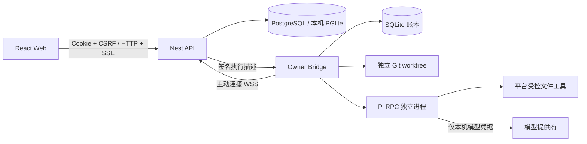

# 执行层架构与不变量

本文保留既有 Bridge 执行安全与恢复机制；v2 群聊与主设备协调入口见 [群聊协调架构](chat-coordination.md)。文中的旧 Owner 人工审批描述仅说明 v1 兼容链，新主流程由协调器按设备策略生成许可。

## 模块职责

API 保存协作、审批、任务和审计事实；Bridge 持有设备私钥并决定本机是否允许执行。浏览器不能直接调用任意本机进程。模型供应商从 Owner 本机接收已批准的上下文和工具结果，云端不会代管模型凭据。

每次提交冻结目标、限制、验收、会话截止点、资料版本、来源哈希和初始模型输入。审批指纹还绑定设备、代码基线、工具与写入目录、预算和结果受众。修改输入先清空审批，再提交修订；签名不是模型生成的授权文本。

## 执行与恢复

1. API 在事务中占用唯一未终结执行槽位，保存 attempt 和描述，再派发许可。
2. Bridge 校验签名与本机策略，先写 SQLite 账本，再申请实际运行租约，之后创建 worktree 和 Pi 进程。
3. 同一 attempt 重复到达，只回报原状态或补传结果。进程句柄属于原调用，重复消息不能移除它。
4. 输出先落本地事件账本，再传云端。服务端只 ACK 连续持久化前缀；重连重放未 ACK 事件。
5. 结束必须确认受管操作返回/进程退出，再保存停止证据和结果。网络失败只重试结果投递，不重跑任务。
6. 无法核清原进程时保留 uncertain / RECONCILING 槽位；Owner 人工核查后通过受保护的本机命令提交明确的人工证明。

取消不是文件回滚。成功与取消竞态由终态事务处理；已经完成的真实执行可上报成功。设备撤销后普通凭证失效，设备私钥仅可对原尝试签署带一次性挑战的停止回执，不能藉此读取资料或领取新任务。

## 上下文与记忆

上下文是单任务的版本快照。历史压缩采用有来源 ID 的原文摘录，近期消息保留原文；明确限制独立置顶。长资料标记为摘录，通过独立的 context.read 短期许可回读原版本；每次回读重查成员、设备、任务与租约。

记忆是候选、已确认、已废弃的项目结论。Member 可以提候选，Owner 确认；任务显式引用确认版本。模型输出不会直接改变记忆状态、资料 ACL、任务状态或审批。

## 列表与生命周期

列表端点返回 data 与 pagination，limit 默认 20、最大 100。游标绑定资源和筛选范围，按 (created_at, id) 或消息/审计序号继续读取；鉴权仍在查询中执行。列表使用摘要，任务/资料详情另取完整内容，任务数量统计独立于当前页面。

维护采用任务父记录锁，发布与清理沿同一锁顺序操作，防止发布已经清理的正文。Owner 的预览与写入通过任务 version 关联，正文变更单独推进 content_revision，浏览器据此重建事件流。保留标记独立于任务终态。云端清理默认关闭，本机文件不由该服务处理。

## 初版边界

代码工具提供读取、列举和获准目录内既有文件的精确替换，没有通用 Shell、PTY、自动 Git 提交或任意测试工具。Windows 使用 SID ACL，POSIX 使用目录/文件 mode 保护私有数据。工具校验与 worktree 不是 OS 沙箱，仍依赖可信仓库、可信 Owner 本机和模型供应商的数据处理边界。
