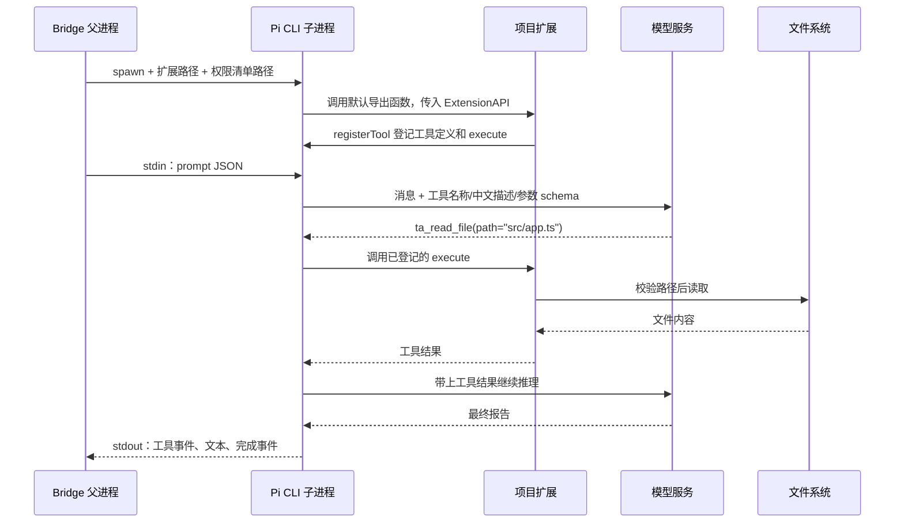

# Pi 工具从加载到执行：代码阅读指南

这份文档对应当前 demo 实现。建议先看完整例子，再按下面给出的顺序打开源码。工具都属于工程源码，不安装到个人 Pi 的 extensions 目录。

## 1. 先分清四个参与者

| 参与者      | 做什么                                                    | 是否真正读写文件                        |
| ----------- | --------------------------------------------------------- | --------------------------------------- |
| Web / API   | 保存群消息，形成目标，比对重复工作，按主设备策略下发任务  | 不通过 Pi 工具操作代码                  |
| Bridge      | 验证许可、准备独立工作目录、启动和停止 Pi、持久化执行结果 | 准备 worktree、收集 diff 等基础设施操作 |
| Pi CLI 进程 | 接收任务，调用模型，把模型选择的工具交给对应 execute 函数 | 工具代码在这个进程内运行                |
| 模型服务    | 理解任务，根据工具名称、中文描述和参数 schema 选择工具    | 通过返回工具调用请求间接使用工具        |

registerTool 的意思是“登记一个可被调用的功能”。登记完成时还没有读取文件。只有模型发出匹配的工具调用，Pi 才执行这个工具的 execute 函数。

## 2. 用一个读取文件的例子走完整条链

假设成员发送：“@AI 分析 src/app.ts 中的实现风险”，且主设备已连接并开放只读执行。

1. API 形成目标、完成已有工作的比对，冻结任务输入，并生成绑定执行尝试的签名许可。
2. Bridge 的 [execute](../../apps/bridge/src/bridge-client.ts) 验证签名与范围，先把执行尝试记入本地账本，再创建独立 Git worktree。
3. Bridge 调用 PiRpcAdapter.run，传入任务快照、worktree 路径、模型配置、预算、取消信号和事件回调。
4. [PiRpcAdapter](../../packages/agent-runtime/src/adapters/pi/pi-rpc-adapter.ts) 为这一次执行写入 guard-manifest.json，设置独立 PI_CODING_AGENT_DIR，并通过 Node spawn 启动工程依赖中的 Pi CLI。
5. 启动参数中的 --extension 是项目内 guard-extension.ts 的绝对路径。Pi 加载这个文件并调用它导出的默认函数，将 ExtensionAPI 作为参数传入。
6. 扩展读取权限清单，按统一工具策略注册只读工具，并安装预算及调用守卫。
7. 父进程向 Pi 的 stdin 写入一行 JSON RPC 请求：

```json
{
  "id": "prompt",
  "type": "prompt",
  "message": "本次任务冻结的目标、约束、验收和上下文……"
}
```

8. Pi 请求模型时，除了消息，还发送工具的名称、description 和参数 schema。execute 函数的源码不会作为工具定义发送给模型。
9. 模型选择读取文件，返回类似下面的工具调用。这里是便于理解的示意格式，具体供应商协议由 Pi 适配：

```json
{
  "name": "ta_read_file",
  "arguments": {
    "path": "src/app.ts",
    "offset": 0
  }
}
```

10. Pi 找到此前登记的 ta_read_file，调用 [read-file.ts](../../packages/agent-runtime/src/adapters/pi/tools/filesystem/read-file.ts) 中的 execute。该函数通过闭包使用权限清单里的 worktree，不接受模型传入任意电脑目录。
11. execute 调用 [file-tools.ts](../../packages/agent-runtime/src/safety/file-tools.ts) 的 readText。它检查目录范围、敏感文件、符号链接、文件大小和文本类型，随后由 Node 文件 API 真正读取文件。
12. 返回的内容被包装为 Pi 工具结果，进入下一轮模型上下文。模型可能继续选工具，也可能生成最终报告。
13. Pi 将工具开始、结束、文本增量等事件写到 stdout。父进程解析逐行 JSON，通过 options.emit 交给 Bridge，后者写账本并上传。
14. 适配器收到 agent_settled 后收尾，并确认子进程退出。Bridge 收集工作目录 diff、持久化报告，再把真实结果回传到群聊。

关键点：一次工具调用发生在 Pi 子进程内部。Bridge 看见工具事件后记录和转发，不再执行一遍相同操作。



## 3. registerTool 中的字段分别有什么用

| 字段        | 谁使用       | 作用                                            |
| ----------- | ------------ | ----------------------------------------------- |
| name        | 模型和 Pi    | 稳定的调用标识，例如 ta_read_file；不能随意改名 |
| label       | 工具展示界面 | 面向人的中文名称                                |
| description | 模型         | 说明何时使用、返回什么、有什么限制              |
| parameters  | 模型和 Pi    | 参数的类型、必填项、取值范围及中文说明          |
| execute     | Pi 运行时    | 收到调用后真正运行的 TypeScript 函数            |

description 写“禁止访问秘密”只能帮助模型正确选择工具，真正的拒绝必须在执行代码中完成。当前的文件边界和来源回读检查都在运行时执行。

## 4. 现在的目录职责

```text
packages/agent-runtime/src/
├─ ports/runtime-adapter.ts           # Bridge 与运行时的接口
├─ safety/file-tools.ts               # 具体文件操作及路径边界
└─ adapters/pi/
   ├─ pi-rpc-adapter.ts               # CLI 进程、RPC、取消和输出
   ├─ guard-extension.ts              # 扩展组装入口
   ├─ guard-manifest.ts               # 单次执行权限清单
   ├─ guard-hooks.ts                  # 预算、会话和调用守卫
   ├─ tool-policy.ts                  # 工具名称及开放条件的唯一清单
   └─ tools/
      ├─ registry.ts                 # 名称到注册函数的显式映射
      ├─ shared.ts                   # 注册函数类型、统一结果包装
      ├─ filesystem/
      │  ├─ read-file.ts
      │  ├─ list-files.ts
      │  └─ edit-file.ts
      └─ context/read-context.ts
```

所有工具经一个 registry 统一组装是合理的；把所有工具的参数、实现和守卫长期堆在扩展入口里，会使维护成本随工具数量增加。

工具数继续增加时，按 filesystem、context、git、testing 等能力分组，并为每组引入独立服务。当前只有“只读 / 获准编辑”两种条件，使用简单清单即可。将来提供测试或 Git 写入时，需要明确的能力、风险与资源配额，不能只把 requiresEdit 改成 false 就开放执行。

## 5. 为什么个人 extensions 目录里没有

当前 Pi 的来源通过 import.meta.resolve('@earendil-works/pi-coding-agent') 解析，是工程锁定的依赖。扩展路径由 --extension 显式指定，源文件仍留在工程中。

- --no-extensions：关闭个人和仓库扩展的自动发现。
- --extension：仍明确加载项目自己的扩展。
- --no-builtin-tools：关闭内置工具，避免出现未纳入项目权限边界的操作。
- --tools：只激活本次清单允许的名称。

父进程、扩展注册及会话守卫共用 tool-policy.ts，避免出现“CLI 允许了工具，但扩展忘记注册”或“只读任务意外激活写工具”的清单漂移。

运行数据默认结构如下；Bridge 的 --data-dir 可以改变根目录：

```text
.local/bridge/default/
├─ state/ledger.sqlite
├─ worktrees/<任务ID>/<尝试ID>/
└─ artifacts/<任务ID>/<尝试ID>/
   ├─ guard-manifest.json
   ├─ context-access.json
   └─ pi-home/
```

pi-home/models.json 只在指定自定义模型配置时复制生成。这些目录存放状态和配置，工具源码仍在 packages 内。手动启动个人 Pi 不会自动带上 Bridge 的参数和权限清单。

## 6. 如何新增一个工具

1. 先确定它需要的授权、输入输出和资源上限；新增执行能力时同时更新协议与主设备策略。
2. 在 tools 下相应能力目录新增独立文件，提供注册函数；label、description 和各参数说明写中文。
3. 在 tool-policy.ts 中声明稳定名称及开放条件。
4. 在 registry.ts 中添加对应注册函数。注册表使用 Record<ApprovedToolName, ToolRegistrar>，漏实现会被 TypeScript 检查发现。
5. 把外部 I/O 和边界检查放在独立服务中，工具层只负责协议适配。
6. 为真实副作用、越权拒绝、停止和预算补充必要验证，再运行工程检查。

不按文件名自动扫描并执行扩展；显式注册更容易审计、控制版本和限制可用能力。

## 7. 推荐阅读顺序与调试位置

先看 guard-extension.ts 的三步组装，再看 registry.ts 和 read-file.ts，随后看 file-tools.ts。最后阅读 pi-rpc-adapter.ts 的 spawn、stdin 写入、stdout 解析和 finally 停止。

调试时依次在以下位置设断点：

1. BridgeClient.execute：任务是否到达本机。
2. PiRpcAdapter.run：使用了哪个 CLI、worktree 和扩展路径。
3. 工具 execute：模型是否真的调用了工具。
4. readText / editText / 回读 fetch：是否因为权限或参数被拒绝。
5. stdout 的 tool_execution_start / tool_execution_end：结果是否回传。

Bridge 和 Pi 是两个进程；只附加 Bridge 的调试器，通常不会自动命中子进程工具的断点，需要对子进程启用调试。不要用 console.log 向 Pi 的 stdout 输出任意文本，它承担逐行 JSON RPC；额外文本可能导致 PI_PROTOCOL_ERROR。临时诊断可用 stderr，仍需避免输出密钥和上下文回读令牌。

当前工具权限检查不等于操作系统沙箱。代码编辑仍限于获准目录内既有文本的精确替换，报告明确标记未运行测试。
